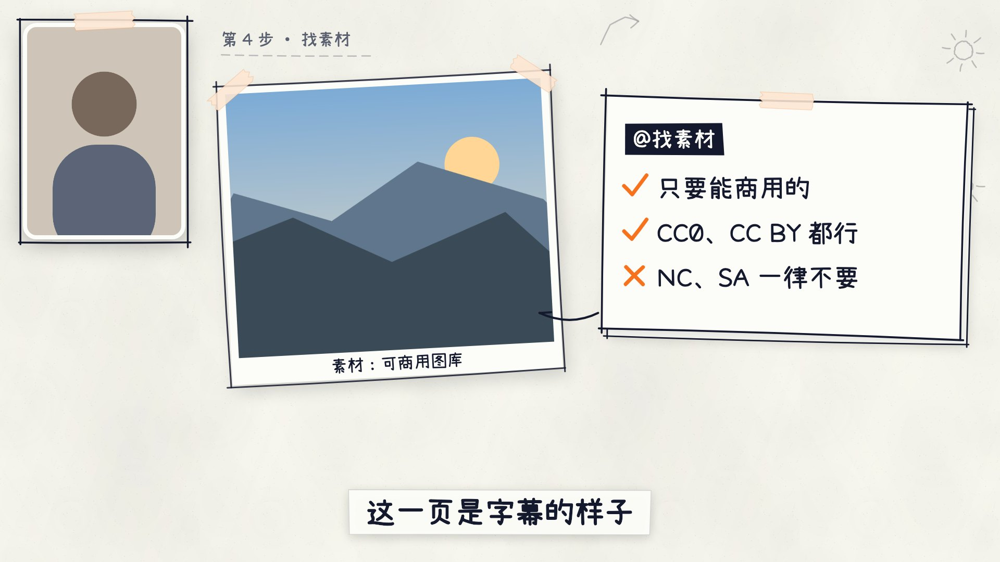
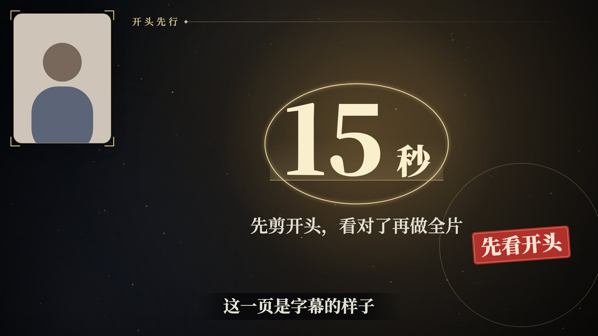
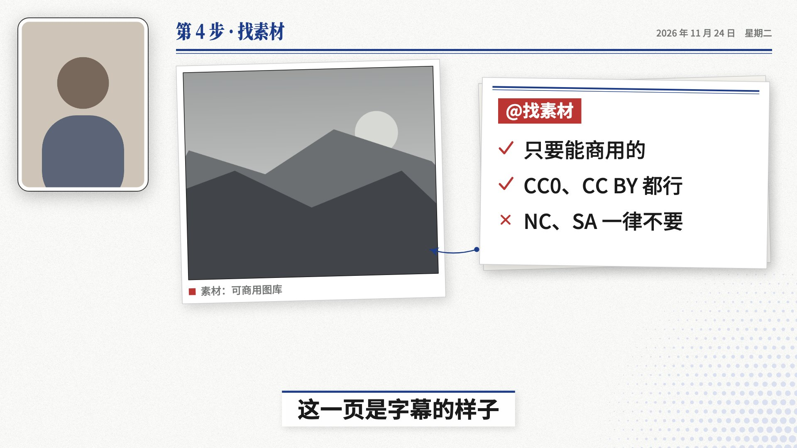

# bruce-ai-jianji：让 AI 帮你剪口播视频

把口播视频交给 AI，说一句「帮我剪辑」。它会一步步带你走完：装环境、建工程、找可商用素材、剪气口、调色、选画面风格。然后先做开头 15 秒给你看，你满意了再做全片，最后按你写的修改表改。

成片是横屏 1920x1080 或竖屏 1080x1920，带动画画面、音效和字幕，抖音、小红书、B 站都能直接发。



## 安装

这是一个 Agent Skill，需要能用技能的 AI 编程助手，比如 Claude Code。

**最简单**：把这个仓库的链接发给你的 AI，说「帮我安装这个技能」。

**手动**（Claude Code）：
```bash
git clone https://github.com/Bruce1008/bruce-ai-jianji ~/.claude/skills/bruce-ai-jianji
```
其他支持 Agent Skills 的工具，把整个文件夹放进它的 skills 文件夹即可。

## 用法

装好后对 AI 说：

> 帮我剪辑

剩下的它会问你。第一次运行会装环境（Python 包、ffmpeg、字体、约 1.5 GB 的转写模型），要 10–30 分钟，之后就不用再装了。

也可以只做其中一步：「帮我剪个气口」「帮我找素材」「按修改表改」。

## 模板（不装技能也能用）

`模板/` 文件夹里的三个文件，点开后右上角下载就行，用别的 AI Agent 剪片子也能用：

| 文件 | 干什么用 |
|---|---|
| [脚本表模板.csv](模板/脚本表模板.csv) | 三列脚本表（口播词 / 画面 / 参考资料）。画面要求多的时候填好，和口播视频一起发给 AI，它照「画面」一列做分镜。用 Excel、WPS、Numbers 打开 |
| [脚本表模板.md](模板/脚本表模板.md) | 同一张脚本表的文字版，带填写说明和发给 AI 的提示词 |
| [修改表模板.xlsx](模板/修改表模板.xlsx) | 看完成片，把要改的地方一行一行写进去（时间、问题、截图、类型），再让 AI「按修改表改」。AI 只读这张表，改完你自己把状态标成「已改」 |

用这个技能时不用自己找模板：建工程时会自动放一份 `修改表.xlsx` 在工程文件夹里。

## 流程

| 步 | 做什么 | 你要做的 |
|---|---|---|
| 1 装环境 | 检查并安装 ffmpeg、Python 包、字体、转写模型 | Mac 装 Homebrew 时输一次开机密码 |
| 2 建工程 | 在你指定的位置建一个带日期的工程文件夹 | 选位置、横屏还是竖屏 |
| 3 放内容 | 读口播稿、检查口播视频 | 把口播稿、口播视频、自己的素材放进去 |
| 4 找素材 | 按口播稿去图库找**可商用**的图片和视频（你选了才找官方引用素材） | 删掉不要的 |
| 5 剪气口 | 转写，收紧停顿，删掉重说和口误 | 听一遍粗剪 |
| 6 调色 | 去黄、提亮，可以照参考图调 | 看对比图 |
| 7 选风格 | 出带你自己画面的风格预览图 | 选一个 |
| 8 开头 15 秒 | 字幕、动画画面、音效，先做开头 15 秒 | 看预览，提意见 |
| 9 全片 | 做完剩下的部分，交付成片、字幕文件、授权清单 | 看成片 |
| 10 改片子 | 按 `修改表.xlsx` 改，出新版本 | 把要改的写进表 |

工程文件夹长这样：
```
2026-11-24_片名/
├── 1_口播稿/       你放：docx、txt、md，或三列脚本表
├── 2_口播视频/     你放：手机、相机拍的都行，只有录音也行
├── 3_素材/         你放自己的素材；找来的/ 是 AI 下载的
├── 4_参考图/       可以不放：调色参考、想要的画面感觉
├── 5_BGM/          可以不放：放一首就自动垫在人声下面
├── _工程/          AI 的工作区
├── 成片/           成片.mp4、字幕.srt、授权清单.md
├── 修改表.xlsx     看完要改的地方写这里
└── 先看我.txt
```

## 画面风格

5 个风格，同一份画面换哪个都能直接渲（看完开头 15 秒不喜欢，换个风格不用重写）：

| 风格 | 样子 | 适合 |
|---|---|---|
| 手绘笔记 | 米白纸上墨蓝钢笔线稿，一种橙色强调，字一个一个写出来 | 概念拆解、学习笔记、教程 |
| 扁平流程图 | 奶油底、琥珀黄色块、特粗黑字、带厚度的彩色块 | 流程、步骤、对比、轻松科普 |
| 黑底科技 | 近黑底、暖光、金色星尘，金色宋体由虚到实浮出来，红色印章 | AI 新闻、发布会、有分量的深度内容 |
| 复古报刊 | 白报纸、藏青和报纸红，压窄宋体标题、打字机正文、黑白新闻照 | 新闻评论、事件复盘、人物故事 |
| 华尔街财经 | 深藏青演播室、金属银标题、金色大数字、金 / 绿 / 红胶囊 | 财经、商业、融资、数字多的内容 |

| | |
|---|---|
|  |  |
|  |  |

每个风格在 `styles/<风格>/风格卡.md` 里有完整说明，通用部件见 `styles/部件.md`。想要别的风格，给 AI 一张参考图或说说想要的感觉，它会照着现有风格改一个新的。

做财经、数据类讲解动画，也可以看看 [wallstreet-explainer](https://github.com/HeyChengC/wallstreet-explainer)（本仓库没有打包，需要的话单独装）。

## 素材和版权

- 默认只找**可商用**素材：CC0、公有领域、CC BY、Pexels 许可、Pixabay 许可。禁商用（NC）、禁改（ND）、相同方式共享（SA）的一律不要。
- **官方引用素材**（公司官网、官方账号发的演示视频）只在你选了才找。每段不超过 10 秒，保留台标。科普、评论类视频一般算适当引用，**接广告、商单的视频不能用**。
- 交付时生成 `授权清单.md`，把里面的署名贴进视频简介。
- 你自己放的素材不查授权，版权由你自己负责。

## 环境

- Mac（苹果芯片或 Intel）、Windows 10/11
- Python 3.9 以上、ffmpeg（第 1 步会自动装）
- 不需要 Node.js，不需要 Chrome
- 硬盘留 3 GB 左右（模型 + 字体 + 渲染中间文件）
- 国内网络能直接用：pip、模型、Homebrew 会自动换国内镜像

## 致谢

- [dashi-animationstyle](https://github.com/chuspeeism/dashi-animationstyle)（大师的AI小灶）：手绘笔记、扁平流程图、黑底科技、复古报刊这几个风格的灵感，以及卡点、丰富度、手机字号这几项检查的思路。本仓库的风格代码都是重新写的。
- [wallstreet-explainer](https://github.com/HeyChengC/wallstreet-explainer)：华尔街财经风格的画面方向参考（代码是重新写的，没有打包它）。
- 大师的AI小灶公开的气口提示词：剪气口的停顿规则。
- 音效：freesound.org 上的 CC0 录音，来源见 [assets/sfx/README.md](assets/sfx/README.md)。
- 图标：[Lucide](https://lucide.dev)（ISC），见 [assets/icons/LICENSE](assets/icons/LICENSE)。
- 字体：小赖字体（Xiaolai）、站酷快乐体、思源黑体、Nunito 等，均为 SIL OFL 开源字体，第一次用时自动下载。
- 转写：OpenAI Whisper（mlx-whisper / faster-whisper）。

## 许可

[MIT](LICENSE)
